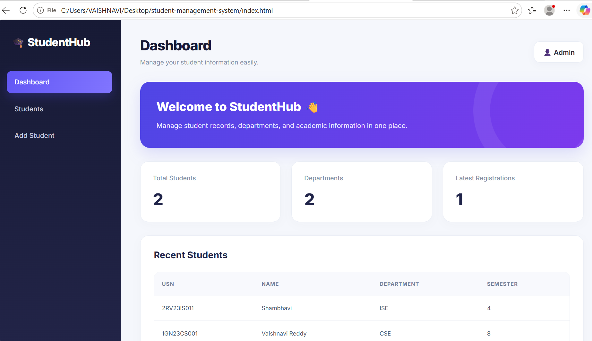
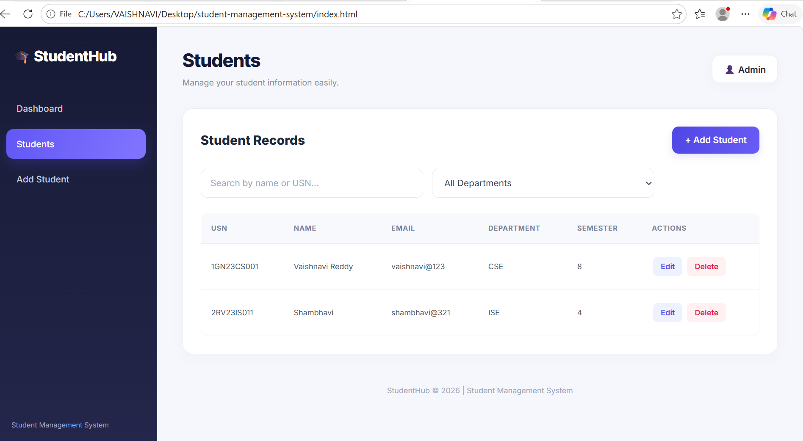
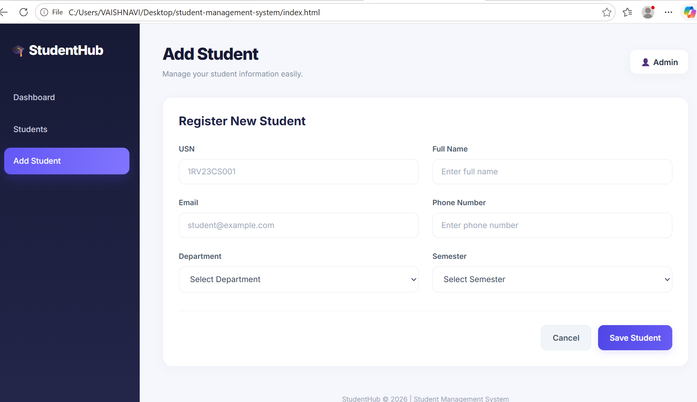

# 🎓 Student Management System

<p align="center">
  <strong>A Smart, Modern & Responsive Student Management Dashboard</strong>
</p>

<p align="center">
  A web-based Student Management System designed to simplify
  student record management with a clean interface and
  user-friendly dashboard.
</p>

---

## 📌 About the Project

The Student Management System is a web development project
that provides an interface for managing student information.

It is designed with a modern dashboard layout, organized
student records, and responsive UI components to make
student information easier to view and manage.

This project demonstrates frontend development skills,
JavaScript functionality, CSS styling, and user interface design.

---

## ✨ Features

- 🎨 Modern and attractive dashboard interface
- 📊 Student statistics and dashboard overview
- 👨‍🎓 Student record management
- ➕ Student registration interface
- 🔍 Student search and filtering (if implemented)
- ✏️ Edit student details (if implemented)
- 🗑️ Delete student records (if implemented)
- 📱 Responsive layout for different screen sizes
- 💻 Clean and organized user interface

---

## 🛠️ Technologies Used

| Technology | Purpose |
|---|---|
| HTML5 | Structure of the application |
| CSS3 | Styling, layout, and responsive design |
| JavaScript | Frontend logic and interactions |
| GitHub | Source code hosting and version control |

---

## 📂 Project Structure

```text
Student-Management-System/
│
├── index.html
├── style.css
├── script.js
└── README.md

---

## 📸 Project Screenshots

### 🏠 Dashboard



### 👨‍🎓 Student Records



### ➕ Add Student



---
